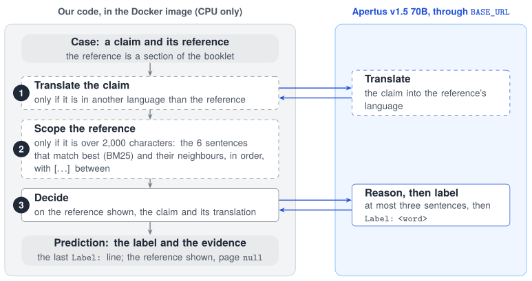
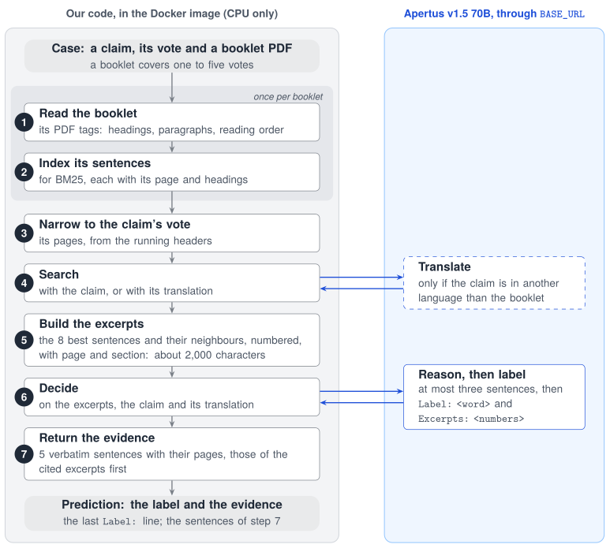

# Technical report — `Multilingual Natural Language Inference over Swiss Official Voting Booklets`

- **Track:** `Track 2A — OST: Multilingual Natural Language Inference over Swiss Official Voting Booklets`
- **Event:** Online
- **Team:** `FactCheckers` — `member`, `member`, `Patrick Giedemann`
- **Demo:** the Docker image `ghcr.io/pgied/apertushack-fact-checking-pub:latest` (no demo video required)
- **Code:** the beginner task is [`gied_beginner_scoped`](src/strategies/gied_beginner_scoped/strategy.py), the advanced task is [`gied_strict_reasoned`](src/strategies/gied_strict_reasoned/strategy.py); the shared retrieval code is in [`src/strategies/_gied/`](src/strategies/_gied/).

## 1. Summary

Every Swiss popular vote comes with an official voting booklet in German, French and Italian. The task is natural language inference (NLI; Dagan et al., 2006; Williams et al., 2018): does the booklet support a claim about the vote (entailment), contradict it (contradiction) or neither (neutral)? Two thirds of the claims are in another language than the booklet, as in cross-lingual NLI (Conneau et al., 2018). The beginner task gives a section of the booklet, the reference. The advanced task gives the whole booklet PDF and asks for the evidence too.

Both of our solutions **retrieve, then verify**, as evidence-based fact checking does (Thorne et al., 2018; Guo et al., 2022): local code finds the few sentences that bear on the claim, and Apertus v1.5 70B judges only those. On all 1,488 cases of the public dataset:

- **Beginner task:** macro-F1 **0.987**, with 834 tokens and 0.6 ms of processing time per case. The baseline prompt reached 0.788, with about 1,900 tokens.
- **Advanced task:** macro-F1 **0.974** and evidence Hit@5 **0.979**, with 1,157 tokens and 3.6 ms per case. Full-document prompting reached 0.70–0.73 and 0.13 on 150 of these cases, with about 34,770 tokens per case.

## 2. Architecture

| Component                                         | What it does                                                        | Where it runs                           |
| ------------------------------------------------- | ------------------------------------------------------------------- | --------------------------------------- |
| The CLI, [`src/entrypoint.py`](src/entrypoint.py) | Reads the cases, decides 8 at a time, writes one JSON line per case | Our Docker image: linux/amd64, CPU only |
| PDFium (`pypdfium2`)                              | Reads the booklet's text from its PDF tags                          | Our Docker image                        |
| BM25, our own Python code                         | Finds the sentences that bear on the claim                          | Our Docker image                        |
| Apertus v1.5 70B                                  | Translates a claim in another language, and decides the label       | A hosted endpoint, through `BASE_URL`   |

There is no OCR, no embedding model and no other model. A case sends one request to Apertus if the claim is in the document's language, otherwise two: a translation, then the decision. In Figures 1 and 2, our code is on the left and the requests to Apertus are on the right. The numbers are the steps of Sections 2.2 and 2.3, and a dashed box is a step that only some cases take.

### 2.1 Shared by both tasks: sentence search and translation

- **Sentences** are the unit of search, since the evidence has to be short and verbatim, and small units fit more of the relevant text into a fixed context (Chen et al., 2024). A sentence never crosses a paragraph or a page, an abbreviation such as "z. B." does not end it, and one under 40 characters joins the next.
- **BM25** ranks the sentences for the claim (k1 = 1.2, b = 0.75; Robertson and Zaragoza, 2009). Words are lower-cased, stripped of accents and cut to their first 7 letters: a language-independent stand-in for stemming (McNamee et al., 2009), which found more evidence than 5, 6 or whole words. A sentence also gets 30 % of its better neighbour's score.
- **Translation:** BM25 needs the claim in the document's language, so Apertus first translates a claim in another language. This is translate-test (Conneau et al., 2018; Artetxe et al., 2023), with the model translating for itself (self-translate; Etxaniz et al., 2024).

### 2.2 Beginner task: a scoped reference

**Figure 1: Beginner task**

1. **Translate** a claim in another language into the reference's language.
2. **Scope** a reference over 2,000 characters, as 1,225 of the 1,488 are: the 6 sentences that match the claim best, each with the sentence before and after it, in the reference's order and with "[…]" for each gap. That is about 2,000 characters.
3. **Decide:** Apertus explains in at most three sentences what the reference says about the claim, then writes `Label: <word>` (the prompt is in Section 3).

The evidence is the reference shown, with page `null`, and none for a neutral answer.

### 2.3 Advanced task: retrieve, then verify

**Figure 2: Advanced task**

1. **Read the booklet** once, when a case first needs it, from its PDF tags (ISO 32000-2 §14.8; PDF/UA, ISO 14289-1), which 59 of the 60 booklets have. They give the headings, the paragraphs and the reading order, without running headers and page numbers. The voting text is untagged, so a page with much untagged text takes its body text from the text layer.
2. **Index its sentences,** each with its page and the two headings above it.
3. **Narrow to the claim's vote.** Running headers such as "Erste Vorlage: …" assign the pages of the booklet's detailed part to its votes, and we keep the vote whose pages share the most rare words and word pairs with the case's vote title. That is a third of a booklet on average, with all gold pages in 989 of the 990 cases with a gold entailment or contradiction.
4. **Search** these pages with the claim, or with its translation if it is in another language.
5. **Build the excerpts:** the 8 best sentences, best first, each with the sentence before and after it on its page, about 2,000 characters in all. Each excerpt names its page and section, for example `[3] (p. 12, Argumente › Zu strikte Vorgaben) …`.
6. **Decide** as in the beginner task, then name the excerpts that decide it: `Excerpts: <numbers>`.
7. **Return the evidence:** five verbatim sentences with their 1-based pages. First those found that are also in a cited excerpt, then the other sentences found, then the rest of the cited excerpts. The vote's title, which starts every gold passage, and fragments under 40 characters are never returned. A neutral answer gets evidence too, since the challenge scores the evidence of every case whose gold label is entailment or contradiction.

### 2.4 Why this design

| Choice                                                     | Why                                                                                                                                                                                                                                                                  |
| ---------------------------------------------------------- | -------------------------------------------------------------------------------------------------------------------------------------------------------------------------------------------------------------------------------------------------------------------- |
| About 2,000 characters of context                          | A reference has 3,700 characters in the median and up to 25,000, a booklet 23,000 to 270,000. Long and distracting contexts lower accuracy (Liu et al., 2024; Shi et al., 2023), and retrieval with a short context can match long-context models (Xu et al., 2024). |
| Only the pages of the claim's vote                         | Claims about the voting text or the summary read alike for every vote, so they had often been judged against another vote's text.                                                                                                                                    |
| The PDF tags                                               | They kept the most of each gold passage: 97.9 % on average, at 3 ms per page. The text layer kept 96.0 % at 1 ms, and Docling (Auer et al., 2024) 95.9 % at 157 ms per page on a CPU.                                                                                |
| Only the supplied booklet                                  | The challenge asks to judge against the supplied source. Searching the booklet's edition in the claim's language as well raised macro-F1 to 0.962 (Table 3), but that edition is in the input folder only when another case uses it.                                 |
| Neutral first, contradiction only with a sentence to quote | Most of the baseline's errors were neutral claims answered contradiction (Section 5). The quote follows the idea of supporting answers with verified quotes (Menick et al., 2022).                                                                                   |
| Reasoning before the label                                 | Reasoning before the answer helps (Wei et al., 2022), and an explanation written after the label cannot change it.                                                                                                                                                   |

## 3. Use of Apertus

- **Model:** `swiss-ai/Apertus-v1.5-70B` (Project Apertus, 2025), at temperature 0. The 8B model served during development and scored lower.
- **How:** inference only, prompted zero-shot, with no fine-tuning. Apertus does two things:
  - **Translation** of a cross-lingual claim, at most 200 output tokens.
  - **The decision:** in both tasks at most three sentences of reasoning, then the label: at most 200 output tokens in the beginner task, and 250 in the advanced task, whose answer also names the excerpts.
- **Where:** a hosted endpoint, called through the OpenAI-compatible chat API at `BASE_URL`: the CSCS Inference API during development, the organisers' proxy at the evaluation. 8 requests run in parallel.
- **The decision's prompt** gives the label definitions below, neutral first, and the claim with its translation under it. In the advanced task it says "booklet" in place of "reference", gives the vote and the numbered excerpts, and says that only the booklet counts, not the model's own knowledge. Only the last `Label:` line of the answer is read, and in the advanced task the last `Excerpts:` line, since the reasoning may name other labels and numbers.

  > - **neutral:** the reference neither supports nor contradicts the claim
  > - **contradiction:** the reference says the opposite of the claim, and you can quote the sentence that does
  > - **entailment:** the reference supports the claim
  >
  > If the reference does not mention what the claim says, or is about another topic, the label is "neutral", not "contradiction": a claim the reference does not support is not contradicted by it.

## 4. Data

- **Dataset:** `OSTswiss/MNLIoverSwissVotingBooklets`, version `v1.1`, pinned to one revision (OST, 2026). It has 1,488 rows, each giving a beginner and an advanced case with the same claim and label. The labels are balanced, the claims are split evenly between German, French and Italian, and two thirds of the cases are cross-lingual. The dataset card gives its licence.
- **Booklets:** the 60 official booklets the dataset refers to, downloaded from the Federal Chancellery (bk.admin.ch). They are public and are not redistributed here, except one for the `make run` sample.
- **Gold pages:** for development only, we locate each reference text in its booklet to measure page hits. The official evidence score matches text only.
- **Personal data:** none.

Swiss voting booklets have also been studied for stance detection (Egli et al., 2023).

## 5. Evaluation

**Metrics.** These are the challenge's own:

- **Macro-F1** over the three labels.
- **Evidence Hit@5,** in the advanced task: one of the first five items, at most 5,000 characters, matches the gold passage with rapidfuzz `partial_ratio` ≥ 90 after normalisation. We compute it as the challenge's `evaluate.py` does.
- **Tokens per case:** input and output, as the API reports them.
- **Processing time per case:** the run's wall-clock time minus the time in which at least one request to Apertus is in flight, divided by the number of cases. We measure it in-process ([`src/timing.py`](src/timing.py)), from when Python starts running our code to the last prediction, on a laptop.

All runs used Apertus v1.5 70B through the CSCS Inference API. The endpoint is not fully deterministic at temperature 0: 4 of 515 labels changed when identical requests were repeated, so differences under about 0.005 are noise.

**Table 1: The solutions against the baselines** (all 1,488 cases, unless noted)

| Task     | System                                           | Macro-F1      | Hit@5     | Tokens per case (in + out) | Processing time per case |
| -------- | ------------------------------------------------ | ------------- | --------- | -------------------------- | ------------------------ |
| Beginner | Baseline: the whole reference, a one-word answer | 0.788         | –         | 1,897 + ≤ 10               | –                        |
| Beginner | **Ours**                                         | **0.987**     | –         | 748 + 86                   | 0.6 ms                   |
| Advanced | Full-document prompting (150 cases, 2 runs)      | 0.701 / 0.727 | 0.128     | 34,762 + ≤ 10              | –                        |
| Advanced | Ours, on the same 150 cases                      | 0.978         | 1.000     | 1,048 + 102                | –                        |
| Advanced | **Ours**                                         | **0.974**     | **0.979** | 1,053 + 104                | 3.6 ms                   |

**Table 2: By language** (all 1,488 cases; the language of the claim, of the document, and whether they differ)

| Cases                                 | Number          | Beginner macro-F1     | Advanced macro-F1     | Advanced Hit@5        |
| ------------------------------------- | --------------- | --------------------- | --------------------- | --------------------- |
| All                                   | 1,488           | 0.987                 | 0.974                 | 0.979                 |
| Claim in German / French / Italian    | 495 / 497 / 496 | 0.980 / 0.990 / 0.990 | 0.966 / 0.978 / 0.978 | 0.967 / 0.985 / 0.985 |
| Document in German / French / Italian | 455 / 569 / 464 | 0.985 / 0.989 / 0.985 | 0.963 / 0.972 / 0.987 | 0.970 / 0.987 / 0.977 |
| Same language / cross-lingual         | 515 / 973       | 0.990 / 0.985         | 0.958 / 0.982         | 0.988 / 0.974         |

Across the nine pairs of document and claim language, macro-F1 ranges from 0.973 to 1.000 in the beginner task, and from 0.923 (German booklet, German claim) to 0.987 in the advanced task.

**Table 3: What each step added** (all 1,488 cases unless noted)

| Task     | Step                                                                                           | Macro-F1  | Hit@5 | Input tokens per case |
| -------- | ---------------------------------------------------------------------------------------------- | --------- | ----- | --------------------- |
| Beginner | Baseline prompt                                                                                | 0.788     | –     | 1,897                 |
| Beginner | Neutral first, reasoning before the label                                                      | 0.901     | –     | 1,952                 |
| Beginner | `quote` definitions, reasoning before the label                                                | 0.962     | –     | 1,984                 |
| Beginner | + the translation of a cross-lingual claim                                                     | 0.965     | –     | 2,092                 |
| Beginner | + only the sentences around the claim (the solution)                                           | 0.987     | –     | 748                   |
| Advanced | Full-document prompting (150 cases)                                                            | 0.70–0.73 | 0.13  | 34,762                |
| Advanced | Only the vote's pages; the model quotes sentences, which are looked up in the PDF              | 0.850     | 0.485 | 11,553                |
| Advanced | Retrieve, then verify: tags, BM25, the edition in the claim's language, a narrow contradiction | 0.927     | 0.957 | 960                   |
| Advanced | + the search with the translated claim, excerpts of both editions                              | 0.953     | 0.987 | 1,471                 |
| Advanced | + only the pages of the claim's vote                                                           | 0.962     | 0.988 | 1,481                 |
| Advanced | Only the supplied booklet: the translated claim alone, shown to the model                      | 0.951     | 0.978 | 1,077                 |
| Advanced | + deciding as in the beginner task, reasoning first (the solution)                             | 0.974     | 0.979 | 1,053                 |

The output adds about 86 tokens per case in the beginner task (the translation and the reasoning), and about 104 in the advanced task (the translation and the reasoning).

**What the steps fixed:**

- **Beginner task:** 274 of the baseline's 498 errors were neutral claims answered contradiction, mostly claims that add a detail the reference does not give. Neutral first, with reasoning, left 140 of them; in 86 of these, the model's own explanation said the reference "does not mention" the claim. The `quote` definitions left 46. Scoping fixed 44 of the 52 errors left after the translation step, 39 of them neutral claims answered contradiction, as irrelevant context distracts language models (Shi et al., 2023). It made 12 new ones, 5 of them contradictions whose deciding sentence was cut away.
- **Advanced task:** an answer in JSON only, label first, with a neutral that covered a claim with a detail the booklet does not give, answered 42 contradictions neutral, often with the opposite in the excerpts. Given 250 tokens instead of 40, it answered neutral in all 42 again. Deciding as in the beginner task left 4.

**Tried and left out:**

- **Paraphrases:** five paraphrases of the claim, searched alongside it (after Hoyle et al., 2023). In the beginner task they reached 0.979, for 2,513 tokens per case. In the advanced task they reached 0.947 on top of the translation, against 0.951 without, for 25 % more tokens; the rankings were merged by reciprocal rank fusion (Cormack et al., 2009).
- **The booklet's edition in the claim's language** (advanced task): searching it as well, with each sentence found there mapped to the sentence at the same relative position on the same page of the booklet, a positional variant of length-based sentence alignment (Gale and Church, 1993), raised macro-F1 to 0.962 and Hit@5 to 0.988. It is left out for the reason given in Section 2.4.
- **Shorter excerpts in the beginner task:** 1,500 characters gave 0.984, and 1,000 characters 0.977, for 800 and 729 tokens per case.
- **Four extra lines in the advanced prompt,** one for each of its main errors (who says what; arguments against a proposal do not contradict what it would do; compare every number; "not mentioned" is neutral): macro-F1 0.973 instead of 0.974, for 11 % more tokens. They fixed 15 errors and made 17 new ones, mostly neutral claims about another topic answered contradiction although the reasoning said the booklet does not mention them.

**Tokens and time.** Narrowing the context cut the tokens per case 2.3-fold in the beginner task and 30-fold in the advanced task, while it raised macro-F1. The processing time leaves out Apertus' latency, which was 1.5 s per case in the beginner task and 1.9 s in the advanced task. That leaves 0.9 s per run of all 1,488 cases in the beginner task, and 5.4 s in the advanced task:

- **Beginner task:** all of it is start-up, mostly Python's imports, half of them the OpenAI client. The search runs while other cases' requests are in flight, so it adds nothing measurable.
- **Advanced task:** start-up takes 0.8 s. Reading the text layer of the 60 booklets before the first request takes 4.6 s, all of which counts. Reading their tags when a case first needs them takes about 17 s, but while other cases' requests are in flight, so practically none of it counts.

## 6. Limitations

- **No held-out split:** prompts and settings were chosen on the same 1,488 public cases we report, so the private benchmark may score lower.
- **Errors left:** in the beginner task, 5 of the errors that scoping introduced are contradictions whose deciding sentence was cut away. In the advanced task, most errors left are wrong answers of contradiction: 18 neutral claims and 10 entailments, most of the 10 same-language claims about what happens if the vote is accepted. Same-language claims are the weaker group (Table 2).
- **Scope** relies on the running headers. A booklet without them is searched whole.
- **No OCR:** all booklets are born-digital. A scanned booklet would have neither tags nor a text layer.
- **Time:** we measure in-process, on a laptop. The organisers time the container from outside, which also counts its start.

## 7. Reproducibility

- **Environment:** `uv sync` in `track_2a/`. All dependencies (`uv.lock`) and the dataset revision are pinned.
- **Data:** `uv run python -m src stage=prepare` downloads the dataset and the booklets.
- **Runs:** `uv run python -m src strategy=gied_beginner_scoped model=apertus-70b` (beginner task) and `uv run python -m src task=advanced strategy=gied_strict_reasoned model=apertus-70b` (advanced task). Each writes its predictions, scores, tokens and processing time to `data/runs/`.
- **The submission:** `make run` builds the Docker image and decides the sample cases. It needs only `API_KEY`, plus `BASE_URL` for another endpoint: no model weights and no GPU.
- **Hardware:** any CPU; all our runs were made from a laptop. Temperature 0, with no sampling.
- **Commit:** `exact commit`.

## 8. Next steps

- **Look into the wrong answers of contradiction** in the advanced task (18 neutral claims, 10 entailments), and into the same-language claims, which are now the weaker group.
- **Hide the rest of the advanced task's processing time:** read each booklet's text layer when a case first needs it, as the tags already are.
- **Validate on a held-out split,** and measure the cheaper 8B model.

## License

Creative Commons Attribution 4.0 (CC-BY-4.0). All HackApertus projects are open-sourced.

## References

- Artetxe, M., et al. (2023). Revisiting Machine Translation for Cross-lingual Classification. _EMNLP 2023_.
- Auer, C., et al. (2024). Docling Technical Report. _arXiv:2408.09869_.
- Chen, T., et al. (2024). Dense X Retrieval: What Retrieval Granularity Should We Use? _EMNLP 2024_.
- Conneau, A., et al. (2018). XNLI: Evaluating Cross-lingual Sentence Representations. _EMNLP 2018_.
- Cormack, G. V., Clarke, C. L. A., Büttcher, S. (2009). Reciprocal Rank Fusion Outperforms Condorcet and Individual Rank Learning Methods. _SIGIR 2009_.
- Dagan, I., Glickman, O., Magnini, B. (2006). The PASCAL Recognising Textual Entailment Challenge. _Machine Learning Challenges, LNCS 3944_.
- Egli, E., et al. (2023). Voting Booklet Bias: Stance Detection in Swiss Federal Communication. _arXiv:2306.08999_.
- Etxaniz, J., et al. (2024). Do Multilingual Language Models Think Better in English? _NAACL 2024_.
- Gale, W. A., Church, K. W. (1993). A Program for Aligning Sentences in Bilingual Corpora. _Computational Linguistics 19(1)_.
- Guo, Z., Schlichtkrull, M., Vlachos, A. (2022). A Survey on Automated Fact-Checking. _TACL 10_.
- Hoyle, A., et al. (2023). Natural Language Decompositions of Implicit Content Enable Better Text Representations. _EMNLP 2023_.
- ISO 32000-2:2020, Portable Document Format, Part 2: PDF 2.0 (§14.8, Tagged PDF); ISO 14289-1:2014, PDF/UA-1.
- Liu, N. F., et al. (2024). Lost in the Middle: How Language Models Use Long Contexts. _TACL 12_.
- McNamee, P., Nicholas, C., Mayfield, J. (2009). Addressing Morphological Variation in Alphabetic Languages. _SIGIR 2009_.
- Menick, J., et al. (2022). Teaching Language Models to Support Answers with Verified Quotes. _arXiv:2203.11147_.
- OST (2026). MNLIoverSwissVotingBooklets, v1.1. _huggingface.co/datasets/OSTswiss/MNLIoverSwissVotingBooklets_.
- Project Apertus (2025). Apertus: Democratizing Open and Compliant LLMs for Global Language Environments. _arXiv:2509.14233_.
- Robertson, S., Zaragoza, H. (2009). The Probabilistic Relevance Framework: BM25 and Beyond. _Foundations and Trends in Information Retrieval 3(4)_.
- Shi, F., et al. (2023). Large Language Models Can Be Easily Distracted by Irrelevant Context. _ICML 2023_.
- Thorne, J., et al. (2018). FEVER: a Large-scale Dataset for Fact Extraction and VERification. _NAACL 2018_.
- Wei, J., et al. (2022). Chain-of-Thought Prompting Elicits Reasoning in Large Language Models. _NeurIPS 2022_.
- Williams, A., Nangia, N., Bowman, S. R. (2018). A Broad-Coverage Challenge Corpus for Sentence Understanding through Inference. _NAACL 2018_.
- Xu, P., et al. (2024). Retrieval meets Long Context Large Language Models. _ICLR 2024_.
